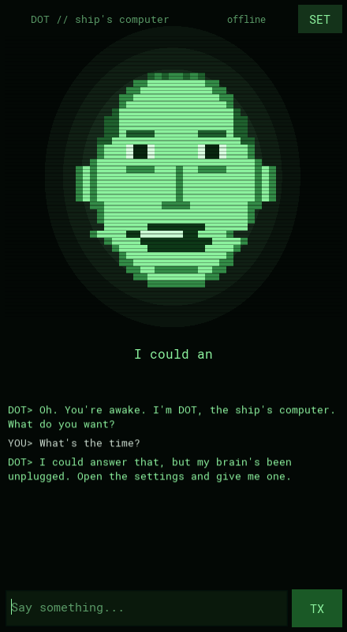

# Deadpan

A small desktop (and Android) front end for LLM chat, fronted by **DOT** — a pixelated,
floating, faintly senile ship's-computer head who answers everything in a flat, dry,
deadpan style. It blinks, raises an eyebrow while it thinks, and its mouth moves while
the reply types out under it like a subtitle, all on a scan-lined CRT screen.



Pure Python + [Kivy](https://kivy.org), so the same code runs on Windows, macOS, Linux
and Android.

## Run it

```bash
python -m venv .venv
source .venv/bin/activate          # Windows: .venv\Scripts\activate
pip install -e ".[claude]"
deadpan                            # or: python main.py
```

It starts in **offline** mode (canned replies, no network) unless it finds
`ANTHROPIC_API_KEY` or `OPENAI_API_KEY` in the environment. Press **SET** to pick a provider.

## Providers

| Provider  | What it talks to | Defaults |
| :-------- | :--------------- | :------- |
| `anthropic` | Claude (Messages API). Uses the official `anthropic` SDK when installed; plain HTTPS otherwise (Android). | model `claude-opus-5-5`, effort `low`, key from settings or `ANTHROPIC_API_KEY` |
| `openai`  | Any OpenAI-compatible `/chat/completions` endpoint: OpenAI, LM Studio, llama.cpp, vLLM, a LiteLLM proxy or a corporate gateway | base URL `https://api.openai.com/v1`, key from settings or `OPENAI_API_KEY` |
| `ollama`  | A local [Ollama](https://ollama.com) server | base URL `http://localhost:11434/v1`, model `llama3.2` |
| `offline` | Nothing | — |

Notes:

- **Corporate Claude access**: set *Base URL* to your company's Anthropic-compatible
  gateway. If the gateway rejects unknown fields, switch off *Refusal fallbacks* (the
  server-side retry on a fallback model when Claude declines a request) and clear *Effort*.
- **Effort** (`low`/`medium`/`high`) trades reply speed for thinking depth; `low` suits chat.
  Clear it for older models that don't support it.
- **Local models on your phone's network**: point the base URL at your computer's LAN
  address, e.g. `http://192.168.1.20:11434/v1`, and start Ollama with `OLLAMA_HOST=0.0.0.0`.

Settings live in `settings.json` in the app's user-data folder (set `DEADPAN_SETTINGS` to
use another path). API keys typed into the settings screen are stored there in plain text;
prefer environment variables on a shared machine.

## The character

The personality is the system prompt in [`deadpan/persona.py`](deadpan/persona.py). Edit it,
or paste your own into the *Persona* box in settings. The face is generated pixel by pixel in
[`deadpan/sprites.py`](deadpan/sprites.py) (32×36 grid, three colour schemes: phosphor,
amber, mono); [`deadpan/head.py`](deadpan/head.py) animates it.

## Package it

### Desktop executable

```bash
pip install pyinstaller
pyinstaller --noconfirm --name Deadpan --windowed main.py
# -> dist/Deadpan/   (on headless Linux, prefix with: xvfb-run -a)
```

Or run the **Desktop build** GitHub Action (Actions tab → *Desktop build* → *Run workflow*),
which builds Windows, macOS and Linux versions and attaches them as artifacts.

### Android APK

Android builds use [Buildozer](https://buildozer.readthedocs.io), which runs on Linux
(or WSL2 on Windows, or macOS):

```bash
pip install buildozer "cython<3.1"
buildozer android debug            # first run downloads the Android SDK/NDK: slow
buildozer android debug deploy run # with a phone plugged in, USB debugging on
```

Or run the **Android build** GitHub Action, which uploads `Deadpan-apk` as an artifact you can
side-load onto your phone.

On Android the Anthropic SDK isn't bundled (its compiled dependencies don't build for
Android), so Claude calls go over plain HTTPS to the same API. Everything else is identical.

## Develop

```bash
pip install -e ".[dev]"
pytest -q
```

```
main.py              entry point (Buildozer and PyInstaller expect it here)
deadpan/app.py       Kivy UI: head, subtitle, chat log, input, settings popup
deadpan/head.py      the animated PixelHead widget
deadpan/sprites.py   face generator and colour palettes (no Kivy)
deadpan/llm.py       chat backends (stdlib only; anthropic SDK optional)
deadpan/config.py    settings dataclass and JSON persistence
deadpan/persona.py   the system prompt
buildozer.spec       Android build config
```

## Ideas for later

- Text-to-speech (a flat monotone, naturally): `pyttsx3` on desktop, `plyer.tts` on Android.
- Streaming replies so the mouth starts moving sooner.
- Conversation memory saved between sessions.
