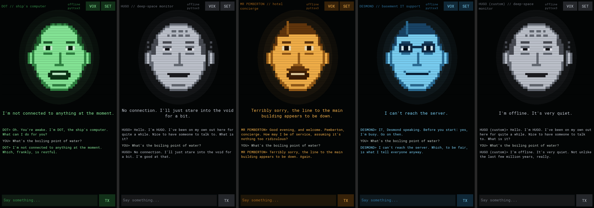

# Deadpan

A small desktop chat app for LLMs, fronted by a pixelated floating head on a CRT screen.
It gives properly useful, informative answers with a dry undercurrent of British sitcom
humour, and reads them aloud while the head blinks, raises an eyebrow as it thinks, and
mouths along with a subtitle.



Pure Python + [Kivy](https://kivy.org): runs on Windows, macOS and Linux, and the same code
can be packaged for Android later.

## Run it

```bash
python -m venv .venv
source .venv/bin/activate          # Windows: .venv\Scripts\activate
pip install -e ".[claude]"
deadpan                            # or: python main.py
```

It starts in **offline** mode (canned in-character replies, no network) unless it finds
`ANTHROPIC_API_KEY` or `OPENAI_API_KEY` in the environment. Press **SET** for settings and
**VOX** to mute or unmute the voice.

## Characters (skins)

A skin bundles a face, colour scheme, personality and voice. All of them share the same
ground rules (in [`deadpan/persona.py`](deadpan/persona.py)): be genuinely useful first,
with dry British wit as the undercurrent, never at the expense of the facts, and drop the
act for anything serious.

| Skin | Look | Character | Voice |
| :--- | :--- | :-------- | :---- |
| **DOT** | green phosphor | ship's computer: bone dry, quietly sardonic, self-declared genius with lapses | medium pace |
| **HUGO** | grey monitor, balding, heavy-lidded | adrift alone in deep space for ages: slow, lugubrious, unflappable, announces the obvious with gravity | slow, low |
| **MR PEMBERTON** | amber, moustache | concierge of a shabby seaside hotel: excruciatingly polite, barely contained exasperation | brisk, higher |
| **DESMOND** | cyan, glasses | basement IT support: weary, pedantic, assumes user error, always fixes it properly | brisk |

### Make your own

Skins are folders in the app's `skins` directory (the path is shown in **SET**). The easiest
start is to export a built-in one and edit it:

```bash
python -m deadpan.skins export hugo ~/my-skin
```

That writes `skin.json` plus five PNG frames (`idle`, `blink`, `think`, `talk1`, `talk2`).
Repaint the PNGs in any pixel-art editor (Aseprite, Piskel, LibreSprite, even Paint), edit
the `character`, `greeting` and `voice` in `skin.json`, and copy the folder into the skins
directory. It appears under *Character* in settings.

`skin.json` fields:

| Field | Meaning |
| :---- | :------ |
| `name`, `tagline`, `greeting` | shown and spoken in the app |
| `character` | the personality, added to the shared ground rules |
| `replace_base_prompt` | `true` to use `character` as the whole system prompt instead |
| `frames` | PNG files per frame (only `idle` is required); omit to use a generated face |
| `face` | generated face options: `hair` (`wisps`/`tufts`/`full`/`bald`), `heavy_lids`, `moustache`, `glasses`, `wrinkles`, `wide` |
| `palette` | `phosphor`, `amber`, `mono`, `cyan`, or a map of colours |
| `voice` | `rate` (words/min), `pitch` (0-99, Linux only), `prefer` (voice names to try, in order) |
| `offline_lines` | what it says when no model is connected |

## Voice

Speech uses whatever the computer already has; no cloud service is needed.

- **macOS**: the built-in `say` command. Skins prefer British voices (Daniel, then Arthur). Add
  more under System Settings → Accessibility → Spoken Content → System voice → Manage voices.
- **Windows**: SAPI voices via `pyttsx3` (installed automatically). For a British male voice,
  add *English (United Kingdom)* under Settings → Time & language → Speech.
- **Linux**: install `espeak-ng` (`sudo apt install espeak-ng`). Pitch works here; try a voice
  override like `en-gb+m3` in settings.

Each sentence is spoken in turn, with the subtitle and mouth kept in step. Code blocks and
links aren't read out ("I've put the code in the log"). To force a particular voice, type its
name in *Voice name override*.

## Model providers

| Provider  | What it talks to | Defaults |
| :-------- | :--------------- | :------- |
| `anthropic` | Claude (Messages API) via the official `anthropic` SDK | model `claude-opus-5-5`, effort `low`, key from settings or `ANTHROPIC_API_KEY` |
| `openai`  | Any OpenAI-compatible `/chat/completions` endpoint: OpenAI, LM Studio, llama.cpp, vLLM, a LiteLLM proxy or a corporate gateway | base URL `https://api.openai.com/v1`, key from settings or `OPENAI_API_KEY` |
| `ollama`  | A local [Ollama](https://ollama.com) server | base URL `http://localhost:11434/v1`, model `llama3.2` |
| `offline` | Nothing | — |

- **Corporate Claude access**: set *Base URL* to your company's Anthropic-compatible gateway.
  If it rejects unknown fields, switch off *Refusal fallbacks* (a server-side retry on a
  fallback model when Claude declines a request) and clear *Effort*.
- **Effort** (`low`/`medium`/`high`) trades reply speed for depth of thinking; `low` suits chat,
  `medium` gives more thorough answers to harder questions.

Settings live in `settings.json` in the app's user-data folder (set `DEADPAN_SETTINGS` to use
another path). API keys typed into settings are stored there in plain text; prefer environment
variables on a shared machine.

## Package it for the desktop

```bash
pip install pyinstaller
pyinstaller --noconfirm --name Deadpan --windowed main.py
# -> dist/Deadpan/   (on headless Linux, prefix with: xvfb-run -a)
```

Or run the **Desktop build** GitHub Action (Actions → *Desktop build* → *Run workflow*), which
builds Windows, macOS and Linux versions and attaches them as artifacts.

## Mobile, later

The code is already Android-ready: Kivy runs there, the Claude call falls back to plain HTTPS
(the Anthropic SDK's compiled dependencies don't build for Android), and speech uses Android's
own TTS through `plyer`. When you want it, `buildozer.spec` and the manual **Android build**
GitHub Action produce an APK; locally:

```bash
pip install buildozer "cython<3.1"
buildozer android debug            # Linux/WSL2/macOS; first run downloads the SDK/NDK
```

Add `plyer` to `requirements` in `buildozer.spec` for voice on Android.

## Develop

```bash
pip install -e ".[dev]"
pytest -q
```

```
main.py              entry point
deadpan/app.py       Kivy UI, settings popup, the speech/subtitle performer
deadpan/head.py      animated PixelHead widget (generated faces or PNG frames)
deadpan/sprites.py   face generator, palettes, PNG export (no Kivy)
deadpan/skins.py     built-in characters, user-skin loading, `export` command
deadpan/persona.py   shared ground rules for every character
deadpan/tts.py       speech: say / espeak / pyttsx3 / plyer
deadpan/llm.py       model backends (stdlib only; anthropic SDK optional)
deadpan/config.py    settings and JSON persistence
```
